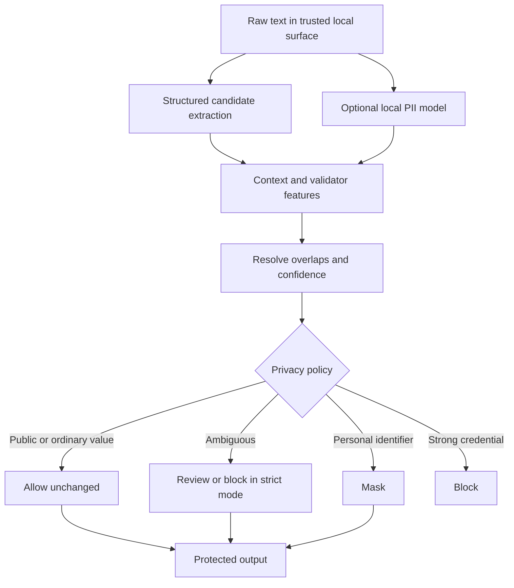
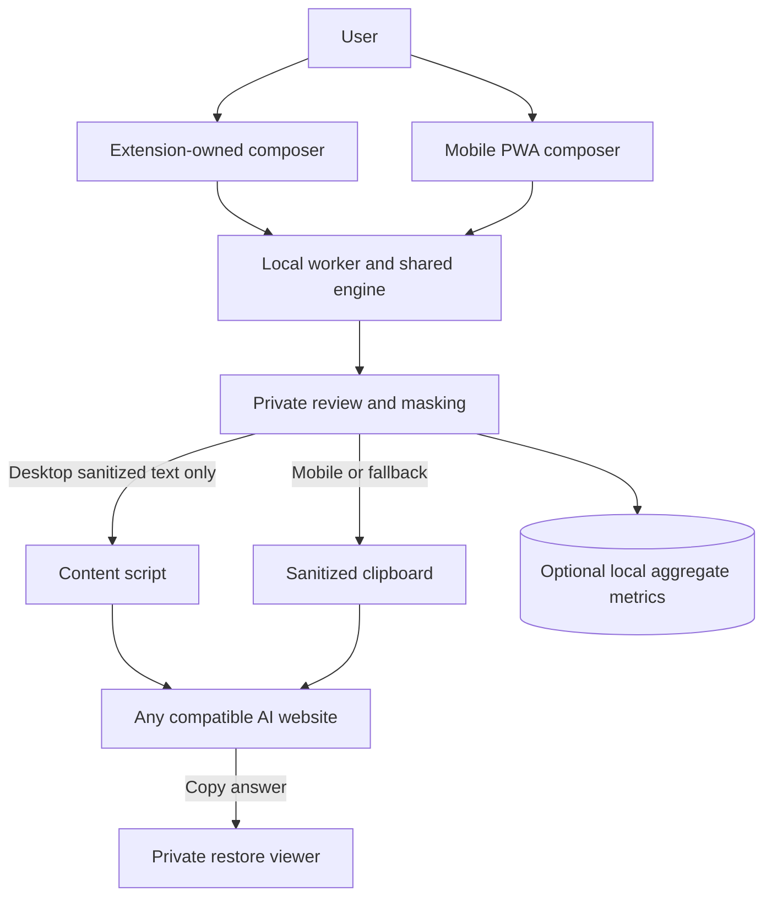
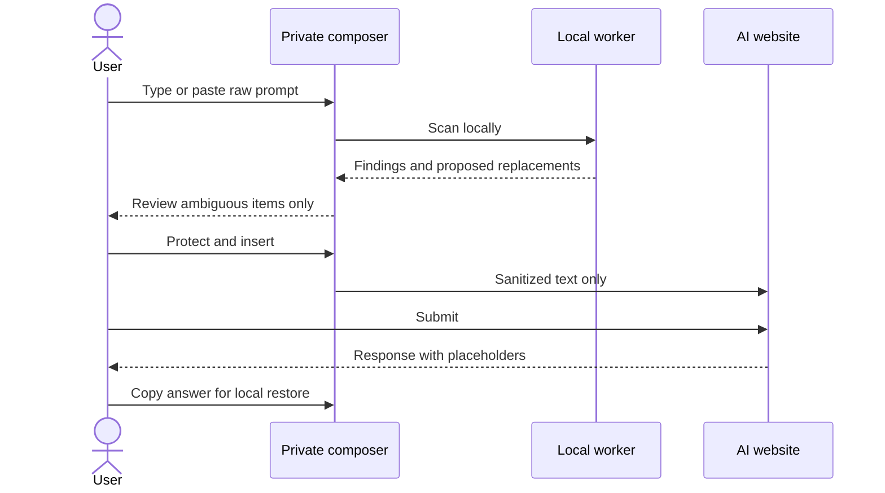
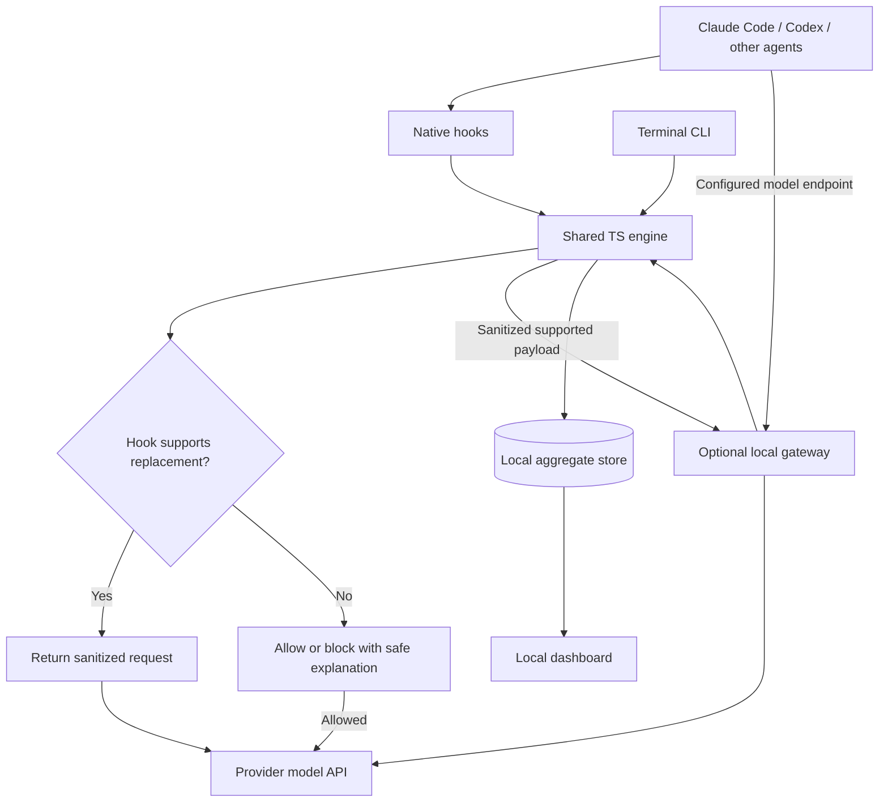
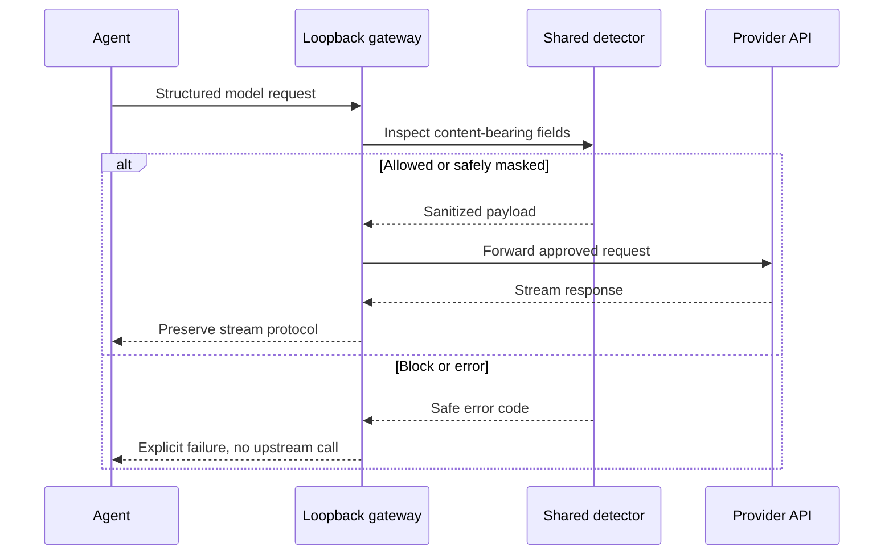

# PromptVeil — Final MVP Development & Codex Challenge Blueprint

**Think freely. Share safely.**

The open-source, local-first privacy layer for AI.

*Private by design. Intelligent by context.*

**Version 6.0 | 24 November 2026 | 30-day solo project**  
**Status:** proposed implementation baseline; no integration or benchmark results claimed.

## Contents
1. [Product](#1-product)
2. [Technology decisions](#2-technology-decisions)
3. [Context-aware detection](#3-context-aware-detection)
4. [Browser architecture](#4-browser-architecture)
5. [Developer architecture](#5-developer-architecture)
6. [Privacy and analytics](#6-privacy-and-analytics)
7. [Repository and release](#7-repository-and-release)
8. [Testing and evaluation](#8-testing-and-evaluation)
9. [Thirty-day plan](#9-thirty-day-plan)
10. [Codex judging strategy](#10-codex-judging-strategy)
11. [Evidence pack and submission](#11-evidence-pack-and-submission)
12. [Development kickoff](#12-development-kickoff)
13. [References and caveats](#13-references-and-caveats)

## 1. Product

### Project identity and branding

| Item | Final identity |
|---|---|
| Product name | PromptVeil |
| Tagline | Think freely. Share safely. |
| Description | The open-source, local-first privacy layer for AI. |
| Brand principle | Private by design. Intelligent by context. |
| GitHub repository | `promptveil` |
| CLI command | `promptveil` |
| Browser extension | PromptVeil |
| Mobile PWA | PromptVeil |
| Coding agent plugins | PromptVeil for Claude Code / PromptVeil for Codex |
| Hackathon project title | PromptVeil — Universal, Context-Aware AI Privacy Firewall |
| Planned website and PWA | `https://YOUR_USERNAME.github.io/promptveil/` |
| Planned repository | `https://github.com/YOUR_USERNAME/promptveil` |
| Planned evidence pack | `https://github.com/YOUR_USERNAME/promptveil/blob/v0.1.0/evidence/README.md` |
| Planned runnable release | `https://github.com/YOUR_USERNAME/promptveil/releases/tag/v0.1.0` |

Use this identity consistently in README, extension manifests, PWA manifest, page titles, CLI help, plugin metadata, release assets, demo and competition evidence. The website is a proposed static GitHub Pages deployment, not a live URL; replace `YOUR_USERNAME` with the actual repository owner before publishing. No custom domain is assumed. Name, package namespace, trademark and domain availability remain unverified. The universal branding describes the product direction, not guaranteed interception of every application.

PromptVeil is an open-source, local-only privacy layer protecting detected sensitive information before it reaches supported AI interfaces. Its distinguishing feature is **context-aware selective protection**, not indiscriminate redaction. A user investing ₹25,000 should not be interrupted. A customer account identifier or genuine credential deserves a different decision. Normal AI provider requests still use the internet; only privacy processing and analytics remain local.

| Surface | Committed MVP | Boundary |
|---|---|---|
| Laptop | Chrome/Edge private composer extension | Raw prompt never enters provider page in protected workflow |
| Mobile | Installable PWA, Android/iOS | Protect and copy; no transparent interception |
| Terminal | CLI accepting stdin or explicit file/text | Explicit input only |
| Coding agents | Claude Code and Codex native guards; full model coverage on one verified route | Only documented, tested hook events or routed model calls |
| Stretch | Gemini CLI BeforeModel, Grok Build, Firefox Android | Advertise only after tests |

No cloud backend, accounts, telemetry, custom model training requirement, system-wide TLS interception, mandatory Python, native mobile interception, attachment/OCR pipeline, or comprehensive MCP egress blocking. No claim of perfect detection. Existing web subscriptions work through sanitized transfer without additional API credentials; agent subscription routing is conditional.

## 2. Technology decisions

Two independent products, one portable TypeScript engine. This supersedes V3's mandatory Python/Presidio worker. User installs only the interface they need. Keep Python for optional offline evaluation and experiments, not runtime.

| Layer | Selected implementation |
|---|---|
| Core | TypeScript, pure functions, Unicode offsets, structured rules and context scoring |
| Optional ML | Rampart quantized MiniLM via Transformers.js / ONNX Runtime Web; Node runtime or WASM after spike |
| Browser | WXT, React, MV3, extension-owned panel/tab, dedicated worker |
| Mobile | React/Vite static PWA, service worker, same engine |
| Developer | Node.js 22+ tested LTS, TypeScript, CLI via Node parseArgs, esbuild |
| Plugins | Small native hooks and installer inspired by Claude-Mem |
| Gateway | Existing compatible Node gateway if suitable; otherwise narrowly scoped Node HTTP streaming relay for one protocol; no general gateway framework |
| Storage | IndexedDB browser; atomic aggregate JSON or built-in SQLite on tested Node version for developer |
| Dashboard | Reusable React components; local-only static viewer |
| Tests | Vitest, Playwright, synthetic mock upstream, GitHub Actions |
| License | Apache-2.0 for original code; third-party notices and separate model attribution |

### 2.1 Model shortlist and size budget

| Candidate | Published weights/package | Decision |
|---|---:|---|
| Deterministic TS rules | No weights | Always enabled |
| wink-eng-lite-web-model | ~1 MB gzipped | Optional linguistic features; not a person/address PII detector |
| Rampart | 14.7 MB ONNX | Primary ML experiment; CC BY 4.0, 17 entity types, Latin-script languages |
| TinyBERT-finetuned-NER ONNX | 14.5 MB INT8 | Generic NER fallback experiment; verify labels and license |
| GLiNER PII Small | ~83 MB reported | Not default |
| Presidio | Python framework plus chosen NLP dependencies | Evaluation oracle only; no mandatory installation |

Rampart is a specialized model with roughly 18.5M parameters and 512 token maximum sequence, combining 4-bit matrix operations with INT8 embeddings [R1]. It is not validated for Hindi/Devanagari or Indian-specific identifiers; benchmark Hinglish and Indic cases separately. Its weights are openly licensed, but attribution and training-source review are required. Do not describe the whole dependency stack as Apache-2.0.

DFKI's optional ML mode reportedly consumes around 1 GB RAM [R4], despite quantization. Reuse its ideas and approved components, not its entire model stack. Rampart's 14.7 MB weight file is NOT the total download or memory footprint. Measure compressed bundle, expanded install, runtime/WASM, tokenizer, peak RSS/worker memory, cold startup and cache size independently.

**Engineering targets, not measurements:** lite browser ZIP ≤3 MB compressed; rules-only CLI JS bundle ≤3 MB excluding an already installed Node runtime; optional ML assets including runtime ≤40 MB compressed (stretch gate, measure); model weights ≤15 MB; no GPU requirement; no default model download; warm p95 ≤50 ms lite and ≤300 ms enhanced for short prompts on reference laptop; ≤800 ms enhanced on reference phone. If runtime exceeds budget, ship lite and make enhanced explicitly optional. Model selection is based on held-out privacy and utility, not bytes alone.

### 2.2 Reuse without reinvention

- Claude-Mem [R5]: plugin layout, hooks, installation and optional local worker lifecycle. Do not copy its transcript persistence or summarization design.
- DFKI Privacy Guardrail [R4]: recognizer and review workflow; do not copy large NER stack or assume paste interception provides strict isolation.
- Gitleaks [R6]: credential signatures and tests; import selected permitted rules, not the Go executable by default.
- Rampart [R1]: existing small model; pin revision, tokenizer and checksum; verify redistribution rights.
- Existing gateway candidates Claude Code Router / LiteLLM [R7]: evaluate transport compatibility and footprint. LiteLLM is not default due to Python/dependency burden. Timebox evaluation to one day.

## 3. Context-aware detection

### 3.1 Pipeline



Rules generate candidates, not final decisions. Use token boundaries, format checks, checksums where applicable, nearby field labels, syntactic relationships, source surface, explicit user rules and model confidence. Negative context is scoped to a candidate, never a whole prompt: a currency amount in a sentence must not suppress an API key elsewhere in the sentence. Strong valid secret signatures override ordinary money context. Preserve original spans with UTF-16 offsets; normalize only with offset tracking, handle emoji and Unicode digits; replace from right to left. Cap regex complexity, length and runtime; do not silently skip oversized input.

| Input (synthetic) | Expected |
|---|---|
| I have ₹25,000 to invest | Allow |
| I earned 25000 this month | Allow default; optional financial-privacy policy |
| Calculate returns on 1234567890 rupees | Allow unless contradictory evidence; review ambiguity |
| Customer ID: 12345678; amount ₹25,000 | Mask ID only |
| My account number is 250001234567 | Mask account; context matters |
| What is Aadhaar? | Allow |
| My PAN is ABCDE1234F | Mask candidate with format/context |
| IFSC: TEST0123456 | Review or mask according to policy; bank routing code alone is not personal PII |
| Explain UPI | Allow |
| Pay to demo@upi | Mask contextual payment handle |
| Email demo@example.invalid | Mask under email policy; allowlisted documentation examples optional |
| Rahul Gandhi gave a speech | Allow likely public reference or review if ambiguous; do not promise public-figure inference |
| My customer Rahul Sharma lives at 12 Example Road | Mask/review personal name/address |
| class CustomerID: pass | Allow source identifier |
| API_KEY=YOUR_API_KEY | Allow known literal placeholder |
| API_KEY=<synthetic valid-shaped secret fixture> | Block |
| Invest ₹25,000; password: demo-secret-value | Allow amount, block credential |

Money, dates, percentages, PIN codes, IPs and names are not automatically treated as sensitive in every context. Account balances or salary tied to identity can be sensitive under a stricter policy. Public vs private identity cannot always be reliably inferred; uncertain names go to review rather than confident automatic classification. Lite mode misses unstructured PII; clearly display coverage.

### 3.2 Decision algorithm

```text
candidate = span + type + evidence + optional model score
if explicit verified secret signature (not known placeholder): BLOCK
else if exact scoped user deny rule: MASK or BLOCK
else if strong identifier validation and relevant context: MASK
else if ordinary numeric/currency/code context and no stronger evidence: ALLOW
else if ambiguous candidate: REVIEW
else: ALLOW
```

Illustrative review thresholds: high score 0.90, medium 0.55, otherwise allow; these are uncalibrated placeholders, not probabilities. Calibrate per entity on validation data; hard secret rules remain independent. Modes: Balanced (default), Strict (block unresolved high-risk cases), Custom (explicit scoped allow/block rules). Browser review is interactive; unattended agent hooks either mask confidently, warn on low-risk ambiguity or block high-risk ambiguity according to policy. Never silently bypass required processing.

### 3.3 Recognizers and model execution

Implement email, phone with region/context, card + Luhn, JWT, private-key markers, known provider keys, database credential strings, PAN, Aadhaar + Verhoeff where appropriate, UPI, customer/account IDs and user-supplied patterns. GSTIN and IFSC are not inherently personal identifiers; apply explicit policy. Treat checksums as evidence, not proof of identity. For ambiguous phone vs amount, consider currency units and phone labels. Do not use a nationwide name dictionary or external identity lookup.

Load optional ML once in a worker on user opt-in. Use pinned local assets, no remote inference, no automatic model CDN fallback, chunk long inputs with overlapping token windows and merge spans. Guard against model load failures; if enhanced mode is required, block transfer, or ask user explicitly to switch to lite. Evaluate default and enhanced independently. A tiny character/token feature classifier could be trained in Python and exported as JSON weights (<1 MB target) later if held-out data shows gains; no need to train during MVP unless existing rules/model fail. Avoid synthetic-only training claims; deduplicate template families across splits.

### 3.4 Shared contract

```ts
type Action = 'allow' | 'review' | 'mask' | 'block';
interface Finding {
  start: number; end: number; type: string;
  action: Action; evidenceCodes: string[];
  score?: number;
}
interface Result {
  status: 'ok' | 'review' | 'blocked' | 'error';
  findings: Finding[];
  sanitizedText?: string;
  mode: 'lite' | 'enhanced';
}
```

Findings never include matched values in serializable analytics. Only trusted local UI may resolve spans against original text. Generate session-scoped random placeholders, stable per value/type in a session; reject literal collisions. Store mapping in memory, expire on close/idle; do not map blocked secrets. Restore exact tokens in local viewer only, not in upstream page or agent tool arguments. Pseudonymization does not eliminate contextual reidentification.

## 4. Browser architecture



Use activeTab and user gesture; content script locates selected editable field and inserts sanitized text using appropriate native setter/input events. No raw prompt or mapping in page DOM, content script or page messages. No global host permission by default. No automatic send; user submits normally. Copy fallback handles unusual editors, future AI sites, Grok, DeepSeek and Perplexity. Test six named sites but label direct insertion vs copy support separately. Chrome MV3 cannot rewrite arbitrary HTTP bodies; Shadow DOM alone is not an isolation boundary [R8].



Mobile PWA caches versioned first-party assets; no third-party scripts, telemetry or external model calls. Show offline-ready status. Mobile Chrome/Safari users use protect-copy-paste; PWA cannot intercept other origins. Firefox Android port optional; Safari extension packaging deferred. Static hosting delivers software only, not prompt data; initial host can see ordinary HTTP asset requests. CSP restricts outbound connections to required same-origin assets, and offline operation verified after cache. OS clipboard, keyboard, browser/OS compromise are outside boundary; advise trusted keyboards and avoid copying raw originals unnecessarily. Mobile memory may be evicted; warn mapping recovery unavailable by default.

## 5. Developer architecture



CLI runs in-process by default; no daemon needed for every user. Optional persistent worker only if enhanced startup latency or multi-turn mapping requires it. Use Claude-Mem's pattern of small hook entrypoints, session lifecycle, local worker and installer without writing raw transcripts or performing remote summaries.

| Agent | Native approach | Full request approach / limitations |
|---|---|---|
| Claude Code | UserPromptSubmit block; PreToolUse guard where appropriate | Native prompt hook not a general rewrite; test supported custom endpoint API-key mode |
| Codex | Documented prompt/tool hooks where supported by installed version | Responses configurable provider; test API key, SSE and tool context; subscription separately |
| Gemini CLI | BeforeModel documented request modification | Strong candidate for full model-bound rewrite without relay; test actual versions/auth modes |
| Grok Build | Inspect supported hooks/config at pinned version | OpenAI-compatible API route if supported; stretch |
| Generic CLI | stdin / explicit files | No automatic control of shell network requests |

Do not intercept or reimplement OAuth, collect tokens, or circumvent provider restrictions. Anthropic subscription credentials have third-party usage restrictions; do not route subscription auth absent explicit authorization and supported configuration. Browser free/paid compatibility does not imply API usage is free. Preserve existing native sign-in for supported blocking hooks. A hook that adds context is not a redaction hook. Test blocking and replacement with an upstream mock, and advertise exact coverage. Shell/MCP/browser tools may transmit independently; not sandboxed by PromptVeil.

### 5.1 CLI and hook interfaces (proposed)

```sh
promptveil protect < prompt.txt
promptveil scan --file sample.txt --json
promptveil install claude-code
promptveil install codex
promptveil doctor
promptveil uninstall codex
promptveil stats
```

Prefer stdin so secrets do not appear in process arguments or shell history. `protect` writes sanitized text only to stdout, diagnostics to stderr; `scan --json` returns redacted findings without values. Exit 0 success, 2 blocked/review required, 3 internal failure. Hook wrappers translate these into documented agent-specific output/exit conventions; verify exact behaviors, do not assume generic exit 2 always blocks. Installer previews config diffs, preserves hooks, backs up without exposing credentials, supports idempotent uninstall; fail clearly on unsupported versions. Use OS-appropriate user-only file permissions.

### 5.2 Optional local gateway



First evaluate existing Claude Code Router; use only if compatible, lightweight and license-approved. Otherwise implement narrow relay for one verified API protocol with Node HTTP/fetch and tested stream handling. No custom universal provider platform. Scan structured message text, system instructions, tool outputs and file-derived text; do not alter model IDs, roles, tool IDs or auth headers. Inspect content-bearing structured fields schema-aware; block unsupported binary/unknown content in strict mode. Cap payload size and timeouts. Preserve streaming event order, status, cancellation, errors, complete tool arguments and retry semantics. Do not restore PII into agent tool calls automatically; user can restore a final answer in local viewer. This may limit coding tasks needing actual identifiers; document it. Local gateway binds loopback only with random local credential, upstream allowlist, Host/origin checks, no wildcard CORS, no arbitrary proxy URL. Never log headers or bodies. If native full request hook works, gateway is not mandatory for that agent.

## 6. Privacy and analytics

Browser IndexedDB and developer aggregate JSON/SQLite retain optional counts only. Default analytics off; enable/clear/export locally. Separate stores by device; no sync. Memory-only mapping with session expiry; no persistent PII vault in MVP. On-device does not mean protected against malware, malicious extensions, OS keyloggers or provider inference from residual context.

```json
{"day":"2026-11-24","surface":"browser","mode":"lite","entityType":"customer_id","action":"mask","count":3}
```

Separate request totals, blocked requests, detection counts and latency buckets. No raw text, file path, user identifiers, model responses, reversible tokens or credentials. Use atomic updates; retention 30 days proposed. Dashboard: requests protected, items masked, blocks, review counts, latency, engine failures, entity breakdown and mode; no claim that each count corresponds to a prevented real leak. CLI stats sufficient if UI schedule slips; React viewer optional local static page with safe aggregates only. No third-party analytics SDK. Fail closed within the protected path on required detector crash, invalid schema or gateway error; direct use outside installed path is not controlled. UI errors never log original prompt.

## 7. Repository and release

```text
promptveil/
  AGENTS.md
  README.md
  LICENSE
  NOTICE
  pnpm-workspace.yaml
  packages/core/            # detector, context, policy, masking
  packages/model/           # optional pinned local assets adapter
  packages/contracts/       # types, schema, test vectors
  packages/ui/              # shared private composer and review
  apps/extension/           # WXT MV3, panel, worker, content script
  apps/pwa/                 # offline mobile composer
  apps/cli/                 # Node CLI, local stats
  apps/gateway/             # conditional verified protocol relay
  adapters/claude-code/
  adapters/codex/
  adapters/gemini-cli/
  tests/fixtures/
  eval/                     # metrics and reproducible scripts
  docs/                     # architecture, ADRs, compatibility, threat model
  evidence/                 # Codex evidence pack
  .agents/skills/           # optional reusable evaluation/release skills
  .github/workflows/
```

Use pnpm with lockfile, TypeScript strict mode, ESLint, Vitest, Playwright, GitHub Actions. Proposed scripts `pnpm install --frozen-lockfile`, `pnpm build`, `pnpm test`, `pnpm eval`, `pnpm release:check` are to be implemented, not existing commands. Release extension ZIP with unpacked instructions, static PWA bundle and CLI package with install/uninstall/doctor. Support Windows and one POSIX platform first; test actual device/browser versions. Node runtime prerequisite is separate from CLI download; avoid forcing installation of Python/GPU. Package optional model separately with checksum and attribution. GitHub Releases SHA256, license inventory and reproducible commands. Use GitHub Pages static PWA if feasible; no server storing prompts. Do not wait for Chrome Web Store approval.

## 8. Testing and evaluation

Create ≥500 synthetic prompts as initial target, including ≥200 benign/hard negatives and representative positives; report actual numbers. Separate held-out real-world-style synthetic templates by family; no real customer PII. Include English, Hinglish, Indic script, financial questions, source code, logs, long text, JSON, adversarial Unicode, overlapping entities and ambiguous amounts. Evaluate per entity and mode. No test credentials that are real. Use mock provider to capture synthetic payloads only.

| Metric | Proposed gate (not achieved) |
|---|---|
| Structured identifier recall | ≥95% on held-out labeled set; publish by type |
| Strong secret recall | ≥98% on supported signatures |
| Mask precision | ≥95% |
| Benign prompt modification rate | ≤2% |
| Benign prompt block rate | ≤1% |
| Unstructured recall | Publish actual; enhanced target ≥85% supported languages |
| Privacy | Zero original marked PII in named protected upstream test cases |
| Restoration | Exact token restoration ≥99% in fixtures |
| Utility | ≥95% benign tasks preserved; assess sanitized task quality separately |
| Latency / footprint | Report cold/warm p50/p95, peak memory, assets by platform |

Precision = TP/(TP+FP); recall = TP/(TP+FN); report span-level and prompt-level separately. Report review rate independently, not as automatic success. Benchmark rules-only vs context-aware rules vs optional ML; record precision/recall/utility/latency and install size. Model score alone not calibrated probability. A library's accuracy is not our measured accuracy. If gate fails, fix or narrow advertised coverage; no falsified metric.

Integration tests: instrument provider DOM/input/network for raw leakage; six website insertion/copy paths; mobile airplane-mode scan; mock gateway with streaming/tool outputs and unsupported content; actual agent multi-turn test; preserve hook configs during install/uninstall; crash/timeout fail-closed; grep logs/DB for synthetic originals; session separation/token collision; XSS/CSP and loopback SSRF/CSRF checks. Test malicious provider response containing fake placeholders, never render raw HTML. Measure user friction (clicks, warnings on benign cases) and completion time. Track model language limitations.

## 9. Thirty-day plan

| Days | Work and checkpoint | Evidence |
|---|---|---|
| 1–3 | Understand, plan, spike browser isolation, model size, native hooks and one full model route | Problem research, ADR, measurements, go/no-go |
| 4–8 | Core rules/context, fixtures, optional model experiment | Baseline comparison, tests, commits |
| 9–13 | Desktop composer, review and sanitized transfer | Six-site matrix, UI screenshots |
| 14–16 | Mobile PWA, offline verification | Android/iOS demo and asset sizes |
| 17–21 | CLI, Claude/Codex hooks, one full route if verified | Mock upstream and actual agent smoke tests |
| 22–24 | Local analytics, installer and docs | Aggregate storage audit |
| 25–27 | Debugging, optimization, hard negatives, security | Before/after metrics and regression fixes |
| 28–30 | Ship, automate, release, evidence pack | CI, tagged runnable release, demo, submission |

Day 3 decision gates: model size/accuracy and license; browser raw isolation; hook actual blocking/rewriting; one full route. If model/runtime too large, ship lite with clear limitations. If gateway route fails, ship agent prompt guard and explicitly state no full context protection. Prioritize one correct full route over four broken adapters. Drop dashboard polish, extra agents and native mobile ports before cutting tests or evidence.

## 10. Codex judging strategy

The following rubric is supplied by the participant. It totals 100 points. The evidence strategy below is a proposed implementation, not an official guarantee of points. The public competition page could not be independently retrieved in this research pass; verify exact stage names, deadline, eligibility, links and evidence format against the workshop/form before submission.

| Criterion | Points | How we address it | Evidence to capture |
|---|---:|---|---|
| Lifecycle Coverage and Depth | 30 | Understand, Plan, Build, Test, Debug, Optimize, Ship, Automate (working stage labels; confirm official wording) | Eight phase records, decisions, commits, tests, actual failures and fixes |
| Codex Capability Use and Fit | 25 | Repo guidance, planning, code edits, terminal tests, diff review, automation; use additional capabilities only when useful | Session excerpts, tool actions, reviewed diffs, CI runs |
| Model and Reasoning-Effort Discipline | 20 | Match model and effort to difficulty; compare outcomes on representative tasks | Actual model IDs, settings, rationale, cost/time if available, verification |
| Working Result and Engineering Craft | 15 | Runnable release, privacy tests, low false positives, clean UX and reproducibility | Tagged release, demo, compatibility matrix, measured metrics |
| Problem Worth Solving and Originality | 10 | Validate privacy pain and false-positive friction; distinguish from upstream projects | User feedback, comparison matrix, original contributions and attribution |

### 10.1 Lifecycle evidence plan

| Stage | Codex task | Acceptance evidence |
|---|---|---|
| Understand | Inspect upstream repositories and requirements; draft threat model and interview questions | Research links, 3–5 voluntary user interviews if feasible, anonymized notes, problem statement |
| Plan | Propose architecture alternatives and risk-first milestones | ADRs, Mermaid diagrams, rejected options, issue backlog |
| Build | Implement small vertical slices against explicit contracts | Commit SHAs, reviewed diffs, unit tests |
| Test | Generate synthetic hard negatives and run tests; review fixture independence | Actual CI/test reports, held-out evaluation |
| Debug | Reproduce genuine failures, isolate cause, make regression test, fix | Failing output, root cause, fix SHA, passing rerun |
| Optimize | Compare rules-only, contextual and enhanced pipeline; profile size and latency | Raw benchmark logs, before/after table, hardware |
| Ship | Audit packaging, install on clean environment, tag release | Release URL, SHA256, installation recording |
| Automate | Implement repeatable CI/eval/release checks | Workflow YAML, successful run URL, reproducible commands |

Do not manufacture failures or retroactively fabricate sessions. Keep planned tasks distinct from completed work. Use Codex on the real project, not just to produce the evidence report.

### 10.2 Model selection and effort

Use the models and effort levels actually exposed by the installed Codex client/account. Record exact displayed identifiers and effort; do not assume a particular model is available. Use lower effort for formatting, small mechanical edits and straightforward tests; medium for feature implementation and integration; high for privacy boundary reviews, protocol issues and difficult debugging. Escalate only when needed; record why. Compare at least two genuine similar tasks or one controlled repeated task, recording quality, elapsed time, test pass rate and token/cost if exposed. Do not invent token counts or attempt to expose private chain-of-thought; record concise decision rationale and observable actions instead. This is distinct from the tiny on-device PII model selection.

### 10.3 Use Codex capabilities deliberately

- Root AGENTS.md: scope, conventions, privacy guardrails, tests, evidence requirements.
- Plan and execute a bounded task with acceptance criteria; inspect the actual diff before accepting.
- Run terminal commands/tests and capture results; use review capability when available.
- Use repeatable skills or scripts for evaluation/release if supported; automation must be useful, not decorative.
- Record human decisions, corrections, rejected suggestions and approvals. Solo participant remains responsible for code and submission.

Official guidance: [AGENTS.md](https://learn.chatgpt.com/docs/agent-configuration/agents-md), [Codex workflow cookbook](https://github.com/openai/openai-cookbook/blob/main/examples/codex/iterating-development-workflows-with-codex.md), [OpenAI engineering practices](https://openai.com/business/learn/how-openai-uses-codex/). Cookbook conventions are recommendations, not contest-mandated file names.

## 11. Evidence pack and submission

A Codex Evidence Pack is a reviewer-accessible collection showing HOW you used Codex throughout development, what decisions were made and what actually worked. It is not just a source-code link or one screenshot. The form asks for its URL; no independently verified mandatory pack layout was found. Recommended: keep a Markdown index plus supporting evidence in the public repository, optionally export a PDF if the organizer requests one.

### 11.1 Repository layout

```text
evidence/
  README.md                 # navigation and rubric crosswalk
  sessions.csv              # task/model/effort/action/results index
  stages/
    01-understand.md
    02-plan.md
    03-build.md
    04-test.md
    05-debug.md
    06-optimize.md
    07-ship.md
    08-automate.md
  sessions/                 # sanitized selected excerpts, not complete private logs
  benchmarks/               # reproducible actual results
  screenshots/              # synthetic demo only
  compatibility.md           # tested version + auth + coverage
  submission-checklist.md
```

Create this on day one. Link every stage entry to commits and session evidence. Daily task workflow: create issue → choose model/effort → run Codex → review changes → run checks → record result → commit → update evidence index. Spend 5–10 minutes after each substantive session. Weekly audit: check links, missing stages, unsupported claims and accidental secrets.

### 11.2 Session record template (copy for each completed task)

```markdown
# Session PS-001 — [task]
- Date/time UTC: [actual]
- Lifecycle stage / issue: [stage / issue URL]
- Codex client/version: [actual]
- Model / reasoning effort: [actual or not exposed]
- Why this setting: [short rationale]
- Input prompt: [sanitized actual prompt]
- Capability used: [plan/edit/test/review/etc.]
- Observable actions: [commands, files, tool outputs]
- Output and verification: [actual results; links to logs]
- Human review: [accepted/rejected changes and reasons]
- Commit SHA / CI URL: [actual]
- Duration / token usage / cost: [actual or unavailable]
- Next step / unresolved risks: [actual]
```

Suggested CSV header: `session_id,date,stage,issue,client_version,model,effort,rationale,capability,verification,commit,ci_url,duration,usage,status,evidence_path`. Keep screenshots of actual model selection where useful. Check `codex --help` and installed version for supported session/export options; if using structured CLI output, first verify supported flags and redact before saving. Never enable broad raw transcript logging on real private data. Do not publish OAuth tokens, system secrets, personal paths, raw prompts containing private data, or hidden reasoning. Use synthetic demo prompts throughout. Add `.gitignore` for private logs, `.env`, caches and auth files; audit staged files and history with secret scanning before publishing. Never commit actual credentials.

### 11.3 Evidence index template

```markdown
# PromptVeil — Codex Evidence Pack
- Project/release: [links]
- Summary: [problem, solution, measured results]
- Lifecycle: [eight stage links]
- Capability use: [session IDs + links]
- Model/effort choices: [session table and comparison]
- Engineering: [CI, evaluation, compatibility, demo]
- Originality: [research, interviews, upstream attribution]
- Known limitations: [honest scope and failed tests]
```

### 11.4 What to enter in the three form fields

| Field | Meaning | Example URL (placeholder; replace with actual public link) |
|---|---|---|
| GitHub Repository Link | Public source code, README, AGENTS.md, commit history, license and installation instructions | `https://github.com/YOUR_USERNAME/promptveil` |
| Codex Evidence Pack Link | Direct URL to the evidence index, not merely the repository homepage | `https://github.com/YOUR_USERNAME/promptveil/blob/v0.1.0/evidence/README.md` |
| Live Project URL / Runnable Release Link | A usable product demo or downloadable version with exact setup instructions | `https://github.com/YOUR_USERNAME/promptveil/releases/tag/v0.1.0` |

A GitHub Pages PWA may optionally be published at `https://YOUR_USERNAME.github.io/promptveil/` for instant mobile/browser demo. It cannot demonstrate all CLI/extension functionality alone. Prefer the runnable release link for the form, with the PWA and demo linked in release notes. No cloud inference is required. Check the organizer accepts a tagged repository evidence index; if they require Drive/PDF instead, provide a view-only evidence PDF with the same links. Test every final URL signed out/incognito. Submit only actual URLs, not these examples. Record submission confirmation and deadline/time zone. No repository or release has been published by this blueprint.

### 11.5 Release/demo checklist

- [ ] Public source, AGENTS.md, meaningful commit history, attribution and licenses.
- [ ] Clean install tested on documented platforms, checksums and versioned assets.
- [ ] Extension ZIP, CLI package, PWA link or offline bundle; clear model opt-in instructions.
- [ ] Demo: allow ₹25,000 investment prompt; mask synthetic customer ID; block fake secret; mobile offline scan; terminal and verified agent path; analytics no raw text.
- [ ] Actual per-entity metrics, false-positive rate, runtime/download size, device/browser versions and known limitations.
- [ ] All rubric evidence indexed, real model/effort records, CI and commit links.
- [ ] Public links tested and form submitted before deadline.

## 12. Development kickoff

Suggested initial AGENTS.md:

```markdown
# PromptVeil development instructions
- Local-only privacy processing; no telemetry, no raw prompts in logs or evidence.
- Use synthetic fixtures only. Do not use real provider keys in tests.
- Prefer existing licensed, pinned components. No new production dependency without size and license review.
- Preserve genuine monetary values and source identifiers; test contextual false positives.
- Raw text must never enter provider DOM before protection. Fail closed within protected paths.
- Browser and developer apps have independent integration layers; share pure core contracts.
- Run targeted tests and lint for every patch; run full evaluation for policy changes.
- Do not claim integration support or metrics without observed test evidence.
- Update the relevant stage record and session index after human review; never fabricate results.
- Keep changes small and document unresolved risks.
```

First Codex task (proposed prompt): "Read AGENTS.md and this blueprint. Inspect the repository and propose a minimal workspace and test harness. Implement only the first vertical slice: currency-aware masking of a synthetic customer ID, a hard-negative investment prompt, and a secret-block test. Run the tests, report exact commands/results, package-size baseline and unresolved issues. Do not build the dashboard or install a large model yet." Review plan first, then authorize changes. Next task: reproduce the upstream Rampart benchmark on a small synthetic local holdout and compare against lite; pin approved dependencies only after measurements. Create ADRs for detection, browser isolation, agent hook vs gateway and release packaging.

## 13. References and caveats

- [R1: Rampart model card](https://huggingface.co/nationaldesignstudio/rampart) and [upstream repository](https://github.com/nationaldesignstudio/rampart): upstream reports 98.42% private-term recall, 91.7% public-term retention under its term-presence measure, and 6.6 ms median Node ONNX latency, on its own 30,000-row held-out evaluation. Policy-aware retention is a different metric. These are not PromptVeil results and do not establish Indian-language coverage or local device performance. Independently reproduce on our fixtures; pin model revision and checksum.
- [R2: ONNX Runtime Web](https://onnxruntime.ai/docs/tutorials/web/) and [Transformers.js](https://huggingface.co/docs/transformers.js/): local inference options; measure actual bundled runtime sizes.
- [R3: winkNLP](https://github.com/winkjs/wink-nlp): optional lightweight linguistic features; not complete PII detection.
- [R4: DFKI Privacy Guardrail](https://github.com/dfki-dsa/pii-guardrail-browser-extension): browser inspiration.
- [R5: Claude-Mem](https://github.com/thedotmack/claude-mem): lifecycle and plugin inspiration, not a proven privacy interceptor.
- [R6: Gitleaks](https://github.com/gitleaks/gitleaks): secret detection references; review license and rule compatibility.
- [R7: Claude Code Router](https://github.com/musistudio/claude-code-router) and [LiteLLM](https://docs.litellm.ai/): evaluate only if needed.
- [R8: Chrome declarativeNetRequest](https://developer.chrome.com/docs/extensions/reference/api/declarativeNetRequest): network API limits.
- [Claude Code hooks](https://code.claude.com/docs/en/hooks), [Codex documentation](https://developers.openai.com/codex/), [Gemini CLI hooks](https://geminicli.com/docs/hooks/reference/): verify at installed versions and supported auth configurations.
- [GitHub Releases](https://docs.github.com/en/repositories/releasing-projects-on-github/about-releases): runnable release packaging.

Fresh research confirmed Rampart's published model specifications and upstream results, and official Codex guidance on repository instructions and observable workflow evidence. Earlier architecture references are retained as research leads; not all were reverified in this pass. No project code, model inference, integration, installation, or benchmark was executed for this document. All performance gates, compatibility targets, timelines and proposed evidence structures are planning decisions pending verification. The contest rubric and three submission fields come from the participant; exact organizer-specific evidence format remains unverified. Review licenses at pinned revisions before redistribution. The default lite mode is deliberately limited for minimal footprint, not equivalent to full NER coverage. 
