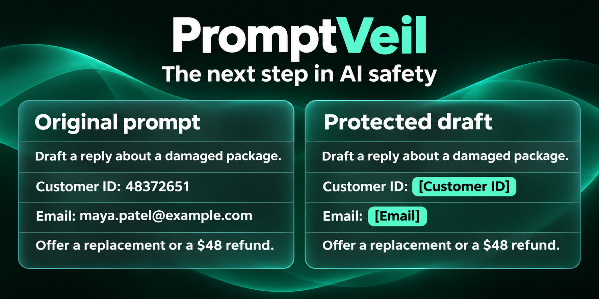

# PromptVeil

**The next step in AI safety.**

PromptVeil makes privacy part of everyday AI use. Before you share a prompt, scan it on your device to mask supported personal details and redact or block detected credentials. Start with the offline web app on a phone or computer, use the Chromium extension in a supported chat, or bring the same protection to your terminal and supported coding agents.

[](https://github.com/JS12540/promptveil/actions/workflows/ci.yml)
[](https://github.com/JS12540/promptveil/actions/workflows/codeql.yml)
[](LICENSE)



[Quick start](#quick-start) | [Documentation](docs/README.md) | [Compatibility](docs/compatibility.md) | [Contributing](CONTRIBUTING.md)

**Project status** | v0.1 prerelease. The [compatibility matrix](docs/compatibility.md) records tested combinations and pending live checks.

## Table of contents

- [Quick start](#quick-start)
- [Publish the extension](#publish-the-extension)
- [Run the website and PWA](#run-the-website-and-pwa)
- [Install the Chrome or Edge extension](#install-the-chrome-or-edge-extension)
- [Install from a browser store](#install-from-a-browser-store)
- [Install the CLI](#install-the-cli)
- [Set up coding-agent guards](#set-up-coding-agent-guards)
- [Run local verification](#run-local-verification)
- [CI and security](#ci-and-security)
- [What you can use](#what-you-can-use)
- [Detection coverage](#detection-coverage)
- [Models and data flow](#models-and-data-flow)
- [Deploy the website to Vercel](#deploy-the-website-to-vercel)
- [Repository layout and contributing](#repository-layout-and-contributing)

## Quick start

From a repository checkout, use Node.js **22.18+** and npm. Run this command in the folder containing `package.json`.

```sh
npm run dev
```

Open [the local preview](http://127.0.0.1:8000/), choose **Open PromptVeil**, paste the synthetic example below, and select **Scan prompt**. The PWA scans locally without an API key.

```text
Before     Draft a friendly reply to a customer whose package arrived damaged. Customer ID: 48372651. Email: maya.patel@example.com. Offer a replacement or a $48 refund.
Protected  Draft a friendly reply to a customer whose package arrived damaged. Customer ID: [PV_CUSTOMER_ID_...]. Email: [PV_EMAIL_...]. Offer a replacement or a $48 refund.
```

PromptVeil generates the placeholder suffixes when it scans.

The running site includes the documentation hub at [http://127.0.0.1:8000/docs/](http://127.0.0.1:8000/docs/). It includes setup, usage, CLI commands, agent guides, troubleshooting, and project reference pages.

See the [installation guide](docs/install.md) or go directly to the [browser extension](#install-the-chrome-or-edge-extension), [CLI](#install-the-cli), and [coding-agent guards](#set-up-coding-agent-guards).

## Publish the extension

This section is for maintainers preparing browser-store releases. To use PromptVeil now, follow the [Chrome and Edge setup](#install-the-chrome-or-edge-extension).

A GitHub release distributes the source and build archives. Each store publishes and updates its own listing. The current repository builds a Chromium Manifest V3 ZIP. It depends on `chrome.sidePanel.open` and a Chromium background service worker. Firefox and Safari need browser-specific packages and verification before submission.

| Target | Publication route | Package status |
| --- | --- | --- |
| Google Chrome | Chrome Web Store | Use the tested Chromium ZIP. |
| Brave desktop | Same Chrome Web Store listing | Verify that the Chromium build opens the private composer and guards the chat in Brave. |
| Microsoft Edge | Microsoft Edge Add-ons | Start with the Chromium ZIP, test it in Edge, and make an Edge-specific package if its API or validation requires changes. |
| Firefox | Mozilla Add-ons | Port the background and composer UI and produce a Firefox-specific ZIP. |
| Safari | Apple App Store | Port the composer, then package the extension inside a signed macOS or iOS app. |

### Prepare a store build

1. **Build and verify the release candidate.** From the intended release commit, use Node.js 22.18+ and Python 3. Run these commands in order.

   ```sh
   npm test
   npm run test:security
   npm run build
   npm run release:check
   ```

2. **Find the upload file.** Use `dist/extension.zip`. Confirm that `manifest.json` is at the ZIP root and its version matches the intended release. Load `dist/extension/` unpacked for your local test.
3. **Test in a clean browser profile.** Run the following on each browser you plan to support:

   - Check that the extension requests the expected permissions and opens its private composer.
   - Paste the fictional damaged-package prompt from [Quick start](#quick-start). Confirm the ID and email are masked and the refund amount is preserved.
   - On a supported chat site, verify insertion, direct paste, Enter, and Send. Type a fresh fictional draft directly into the chat and confirm the first Send attempt leaves a masked draft ready for review.
   - Try the synthetic credential from the [unpacked extension guide](#install-the-chrome-or-edge-extension) and confirm the guard blocks it.
   - Test both a fresh install and an upgrade when a previous release exists. Record results in the [compatibility matrix](docs/compatibility.md).

4. **Prepare the listing and review materials.**

   - Write a short description of the extension's purpose and prepare its icon and screenshots using fictional data.
   - Provide a public privacy policy URL and a support link. Explain on-device scanning, session-only restoration, and what the chosen AI service receives when a user submits a draft.
   - Explain the permissions for the submitted build. `activeTab` supports user-initiated access, `scripting` inserts approved text, `sidePanel` hosts the private composer, and the named host permissions enable automatic guards on supported sites.
   - Prepare reviewer instructions with a supported chat site, the fictional input, and the expected behavior. [Chrome listing assets](https://developer.chrome.com/docs/webstore/cws-dashboard-listing) | [Chrome privacy fields](https://developer.chrome.com/docs/webstore/cws-dashboard-privacy) | [PromptVeil threat model](docs/threat-model.md)

### Google Chrome and Brave

1. **Set up your publisher account.** Sign in and complete registration and account verification. [Chrome Developer Dashboard](https://chrome.google.com/webstore/devconsole) | [Registration guide](https://developer.chrome.com/docs/webstore/register/)
2. **Upload the ZIP.** Select **Add new item**, choose `dist/extension.zip`, and upload it.
3. **Complete the submission.** Add the description and screenshots under **Store listing**, complete the data and permission disclosures under **Privacy**, choose visibility and regions under **Distribution**, and provide the fictional test steps under **Test instructions**.
4. **Submit for review.** Choose whether to publish automatically after approval or publish manually when ready. [Chrome publishing guide](https://developer.chrome.com/docs/webstore/publish)
5. **Verify the live release.** Open the public listing while signed out, install it in a fresh Chrome profile, and rerun the sample. Test installation and guard behavior from the same listing in Brave before advertising Brave support. Record the official listing URL and version in the release notes. [Brave installation guide](https://brave.com/learn/using-chrome-extensions-in-brave/)

### Microsoft Edge

1. **Set up your publisher account.** Register for the Edge extension program in [Partner Center](https://partner.microsoft.com/dashboard).
2. **Upload the Edge-tested package.** In the Edge workspace, select **Create new extension** and upload the ZIP you verified in Edge.
3. **Complete the submission.** Fill in availability, extension properties, privacy information, and store listing assets. Add synthetic test steps in the certification notes.
4. **Submit and verify.** Select **Publish** to start certification. Once the listing is live, use **Get** in a fresh Edge profile and repeat the sample test. Record the official URL and version. [Microsoft Edge publishing guide](https://learn.microsoft.com/en-us/microsoft-edge/extensions/publish/publish-extension)

### Firefox

1. Replace the Chromium side panel with a Firefox sidebar or extension-owned page. Use a Firefox-supported background entry and test messaging, tab permissions, clipboard access, and insertion. Set a stable `browser_specific_settings.gecko.id` and the required data collection declaration for the submitted build.
2. Test the port in Firefox using a temporary installation. Package the Firefox build with the manifest at the root. Ship a separate source archive and exact build instructions for reviewers because PromptVeil generates its distributable JavaScript.
3. Sign into the Mozilla Add-ons Developer Hub, choose **Submit a New Add-on** and **On this site**, then upload the Firefox ZIP. Complete validation, platform selection, metadata, and source upload. After Mozilla signs and lists it, verify installation in a clean Firefox profile and record the listing URL. [Mozilla Developer Hub](https://addons.mozilla.org/developers/) · [Firefox manifest background support](https://developer.mozilla.org/en-US/docs/Mozilla/Add-ons/WebExtensions/manifest.json/background) · [Firefox data consent](https://extensionworkshop.com/documentation/develop/firefox-builtin-data-consent/) · [Mozilla submission](https://extensionworkshop.com/documentation/publish/submitting-an-add-on/) · [Mozilla source requirements](https://extensionworkshop.com/documentation/publish/source-code-submission/)

### Safari

1. Port the private composer to a Safari-supported popup or extension page. Review the manifest and API compatibility for each intended Mac, iPhone, and iPad target, then test the guard and website permission prompts on those targets.
2. Enroll in the Apple Developer Program and create an App Store Connect app record with a stable bundle ID. Package the Safari-ready extension with the Safari Web Extension Packager in App Store Connect, or on a Mac run `xcrun safari-web-extension-packager /path/to/safari-ready-extension` and configure the generated Xcode project's signing for your team.
3. Test the containing app and extension through TestFlight. Complete the listing, support URL, App Privacy answers, and reviewer instructions. Select the build and submit to App Review. Once it is available, verify a clean install and enable it in Safari on every platform you advertise. [Safari compatibility assessment](https://developer.apple.com/documentation/safariservices/assessing-your-safari-web-extension-s-browser-compatibility) · [App Store Connect packaging](https://developer.apple.com/documentation/safariservices/packaging-and-distributing-safari-web-extensions-with-app-store-connect) · [Xcode packaging](https://developer.apple.com/documentation/safariservices/packaging-a-web-extension-for-safari)

For updates, increment the extension version, build from the matching release tag, and submit a new package to each existing store listing. Use the same listing or app identity so current users can receive updates. For Safari, also advance the containing app's build number. Verify fresh installation and upgrade before updating public links. [GitHub release procedure](docs/releasing.md) · [Chrome update procedure](https://developer.chrome.com/docs/webstore/update/)

## Run the website and PWA

From the repo root in the VS Code terminal, use Node.js **22.18+** and npm.

```bash
npm run dev
```

1. Open [http://127.0.0.1:8000/](http://127.0.0.1:8000/) for the landing page.
2. Select **Open PromptVeil** or open [the PWA](http://127.0.0.1:8000/app/).
3. Enter `Draft a friendly reply to a customer whose package arrived damaged. Customer ID: 48372651. Email: maya.patel@example.com. Offer a replacement or a $48 refund.` and click **Scan prompt**. Verify that the customer ID and email are masked and the $48 refund stays intact.
4. Try `Password: never-valid-fixture`. The output should read `Password: [PV_REDACTED]`. For pasted configuration, enable **Mask all config values, including unknown fields**.
5. Wait for **Ready to scan offline**. Stop the preview with `Ctrl+C`, reload the already-open PWA URL in the same browser profile, and scan the first example again.

These commands need Node and npm. Restart `npm run dev` after source edits. If port 8000 is in use, start with `PORT=8001 npm run dev` on macOS or Linux and open port 8001.

### Install on a phone

Use a deployed HTTPS address on the phone and open the **Open PromptVeil** link. In Android Chrome, use the app’s install button when available or the browser menu. In iPhone Safari, use **Share → Add to Home Screen** and enable **Open as Web App** if offered. Launch from the new icon, wait for offline readiness, enable airplane mode, and repeat the synthetic scan. Remove it through your home screen or app settings. [Chrome web app installability](https://developer.chrome.com/docs/lighthouse/pwa/installable-manifest/) · [Apple web app installation](https://support.apple.com/guide/iphone/open-as-web-app-iphea86e5236/ios/27)

## Install the Chrome or Edge extension

1. From source, run `npm run build` with Node.js 22.18+ and Python 3. The release build packages the extension and CLI. From a published release, extract `extension.zip`.
2. Open `chrome://extensions` or `edge://extensions`. Enable **Developer mode**, select **Load unpacked**, and choose `dist/extension/` or the extracted folder containing `manifest.json`.
3. Open a supported chat site and refresh the tab after installing or reloading the extension. Click **Write with PromptVeil** to open Chrome’s private side panel. The PromptVeil toolbar icon is another way to open the composer on these sites.
4. Type `Draft a friendly reply to a customer whose package arrived damaged. Customer ID: 48372651. Email: maya.patel@example.com. Offer a replacement or a $48 refund.` **in PromptVeil**. Select **Protect and insert**, or press **⌘+Enter** on macOS or **Ctrl+Enter** on Windows/Linux. The draft should mask the customer ID and email and preserve the $48 refund. Review the draft and send it when ready.
5. Try `Password: never-valid-fixture`. PromptVeil should block the transfer. To uninstall, select **Remove** on the browser extensions page.

The in-page launcher is configured for ChatGPT, Claude, Gemini, Grok, DeepSeek, Perplexity, Microsoft Copilot, Mistral Vibe, Poe, and Qwen. The extension accesses those sites to place protected text into the chat editor. On other HTTPS chat sites, focus the empty message field before opening PromptVeil from the toolbar and choose **Protect and insert**. A protected copy option appears if direct insertion is unavailable. Keep the native chat editor empty for the first transfer. See the [compatibility matrix](docs/compatibility.md) for live verification status. [Chrome Side Panel API](https://developer.chrome.com/docs/extensions/reference/api/sidePanel)

### Paste directly into a supported chat

After loading or reloading PromptVeil, refresh the chat page. Hover over **Write with PromptVeil** to confirm that the updated native guard is active. Copy the full synthetic text `Draft a friendly reply to a customer whose package arrived damaged. Customer ID: 48372651. Email: maya.patel@example.com. Offer a replacement or a $48 refund.` and paste it into the native chat editor. PromptVeil cancels the original paste and inserts approved plain text at the current selection. The customer ID and email should be masked, and the $48 refund should stay intact. A detected credential blocks the paste. An ambiguous result stays out of the editor until you review it in the PromptVeil composer. On a recognized chat editor, Enter and Send also check the current draft. A clean draft proceeds immediately. If the guard masks an existing draft, review the result and send it again. Detected credentials and unresolved findings pause Send. During a scan started in the private composer, recognized Enter and Send actions in that chat tab are canceled until scanning and insertion finish. Press Send again after reviewing.

When you type directly, a brief pause triggers local feedback while leaving the draft editable. Enter and Send scan the latest text immediately, including inputs such as `Cusotmer id : 1234455`. The private composer is available when you want to scan before placing text on the provider page. Use **Open guard diagnostics in a new tab** from the extension popup to see the build and event counts. [Browser test steps](docs/install.md#debug-native-paste-or-send)

## Install from a browser store

Store listings are pending. The [local installation steps](#install-the-chrome-or-edge-extension) are available now. Once a listing is live, the maintainer will link it here and in the GitHub release notes.

### Chrome public installation

1. In a regular **desktop Chrome** window, open the official PromptVeil listing linked from this README. Check the publisher name, choose **Add to Chrome**, review the requested permissions, and choose **Add extension**.
2. Click the puzzle-piece **Extensions** icon beside the address bar. Pin PromptVeil if you want its icon always visible.
3. Open `chrome://extensions` or choose **Extensions → Manage extensions**. Make sure the PromptVeil toggle is on. Under **Details → Site access**, allow access to the supported chat sites you want guarded. Automatic paste and Send protection needs that site access. Refresh any chat tab already open.
4. Open a supported chat, click **Write with PromptVeil**, and try `Draft a friendly reply to a customer whose package arrived damaged. Customer ID: 48372651. Email: maya.patel@example.com. Offer a replacement or a $48 refund.` The inserted draft should mask the fictional customer ID and email and preserve the $48 refund.
5. If you previously loaded an unpacked build, disable or remove that copy after the store version is installed so both copies do not handle the same chat. A managed work or school profile may restrict installation. On phones, see [the PWA installation guide](#install-on-a-phone). [Chrome installation and site access](https://support.google.com/chrome/answer/2664769)

### Other browsers after publication

| Browser | Install and enable |
| --- | --- |
| Brave desktop | Open the official Chrome Web Store listing in Brave and choose **Add to Brave**. Manage the toggle under **Menu → Extensions**. [Brave installation guide](https://brave.com/learn/using-chrome-extensions-in-brave/) |
| Microsoft Edge desktop | Open the official Edge Add-ons listing, choose **Get**, and confirm **Add extension**. Manage it in `edge://extensions`. Edge also allows installation from the Chrome Web Store when your browser permits extensions from other stores. [Microsoft installation guide](https://support.microsoft.com/en-us/edge/add-turn-off-or-remove-extensions-in-microsoft-edge) |
| Firefox | Open the official Mozilla Add-ons listing, choose **Add to Firefox**, and confirm the permission prompt. Manage the extension in `about:addons`. [Mozilla installation guide](https://support.mozilla.org/en-US/kb/find-and-install-add-ons-add-features-to-firefox) |
| Safari | Install the containing app from the App Store. On Mac, select PromptVeil in **Safari → Settings → Extensions**. On iPhone or iPad, open **Settings → Apps → Safari → Extensions** and enable it. Grant access to the supported sites when prompted. [Safari on Mac](https://support.apple.com/guide/safari/extensions-sfri32153/mac) · [Safari on iPhone](https://support.apple.com/en-ie/guide/iphone/iphab0432bf6/27/ios/27) |

## Install the CLI

Use the tarball from a tagged release or generate it with `npm run build`. Python 3 is used during release packaging. The installed CLI runs on Node.js.

```bash
npm install -g ./dist/cli/promptveil-0.1.0.tgz
promptveil --help
printf '%s\n' 'Draft a friendly reply to a customer whose package arrived damaged. Customer ID: 48372651. Email: maya.patel@example.com. Offer a replacement or a $48 refund.' | promptveil protect
printf '%s\n' 'Draft a friendly reply to a customer whose package arrived damaged. Customer ID: 48372651. Email: maya.patel@example.com. Offer a replacement or a $48 refund.' | promptveil scan --json
```

`protect` writes approved text to stdout. `scan --json` reports the status and findings without matched values. `scan --file PATH --json` reads a local file. Exit codes are `0` for success, `2` for a block or required review, and `3` for a processing failure. Run from source with `node apps/cli/index.ts protect`. On Windows, pipe synthetic text with PowerShell. Uninstall any configured hooks first, then run `npm uninstall -g promptveil`.

Use `promptveil protect --redact` for source code, logs, or mixed text. It recognizes common credential assignments and environment writes across languages without requiring a language setting. Use `promptveil protect --config < settings.yaml` to mask unknown configuration values as well. That mode handles JSON scalar values and common YAML, TOML, INI, properties, and shell assignment forms. The narrower `--dotenv` mode remains available. These commands write a masked copy to stdout. The Codex relay automatically redacts supported model-bound tool results, including structured environment maps. [Protection boundaries](docs/threat-model.md)

## Set up coding-agent guards

Install the CLI first. The hook installer currently targets macOS and Linux. The first install command previews the change. `--apply` writes the user config while preserving other hooks. `doctor` checks the installed command. Confirm behavior in the agent after installation.

### Claude Code

```bash
promptveil install claude-code
promptveil install claude-code --apply
promptveil doctor claude-code
```

PromptVeil installs `UserPromptSubmit` in `~/.claude/settings.json` or the configured `CLAUDE_CONFIG_DIR`. Restart Claude Code and review the hook under `/hooks`. Submit `Draft a friendly reply to a customer whose package arrived damaged. Customer ID: 48372651. Email: maya.patel@example.com. Offer a replacement or a $48 refund.` using synthetic data. Expect a blocked submission. Protect the text with the CLI and submit the protected result. Remove with `promptveil uninstall claude-code --apply`. [Claude Code hook reference](https://code.claude.com/docs/en/hooks)

### Codex

```bash
promptveil install codex
promptveil install codex --apply
promptveil doctor codex
```

PromptVeil installs `UserPromptSubmit` in `~/.codex/hooks.json` or the configured `CODEX_HOME`. Open interactive Codex, run `/hooks`, review the PromptVeil entry, and trust that exact definition. Submit the synthetic ID and expect it to be blocked. Remove with `promptveil uninstall codex --apply`. [Codex hook configuration and trust](https://learn.chatgpt.com/docs/hooks)

For an isolated **Codex relay** smoke test, run `node tests/e2e/codex.mjs` with Codex CLI **0.172.0**. It uses a mock upstream and needs a working loopback listener. For a live synthetic check:

1. In terminal A, set `OPENAI_API_KEY` privately, generate the separate local token with `export PROMPTVEIL_GATEWAY_TOKEN="$(node -p 'require("node:crypto").randomBytes(32).toString("hex")')"`, and run `promptveil gateway`.
2. In terminal B, set the same local token. Run `relay_home="$(mktemp -d)"`, then `promptveil profile codex > "$relay_home/config.toml"` and `CODEX_HOME="$relay_home" codex`. Keep the upstream API key in terminal A.
3. Try a benign synthetic request and a synthetic password prompt. Confirm the benign request completes and the relay rejects the password. Stop the relay and reopen Codex normally to return to your original route.

See the [relay setup and rollback guide](docs/install.md#codex-relay). [Codex provider configuration](https://learn.chatgpt.com/docs/config-file/config-reference)

### Cursor Agent Chat

```bash
promptveil install cursor
promptveil install cursor --apply
promptveil doctor cursor
```

This configures Cursor’s native `beforeSubmitPrompt` event in `~/.cursor/hooks.json`. Restart Cursor if the change is not picked up. Open local **Agent Chat**, submit the synthetic customer ID, and confirm the block before relying on the integration. Check Cursor’s Hooks output for setup issues. Run `promptveil uninstall cursor --apply` to remove the entry. This installer targets the local user configuration. For other editors, use the CLI or PWA to protect text before pasting. [Cursor hook configuration and protocol](https://cursor.com/docs/hooks)

### Gemini CLI

```sh
promptveil install gemini
promptveil install gemini --apply
promptveil doctor gemini
```

The installer adds a `BeforeAgent` hook to `~/.gemini/settings.json` or the `.gemini` folder under `GEMINI_CLI_HOME`. Restart Gemini CLI and submit `ACME_API_KEY=fixture-never-valid` to check that the guard stops the turn. Use `promptveil uninstall gemini --apply` to remove the hook. Gemini CLI protocol and installer fixtures passed. Live Gemini CLI verification is pending. [Gemini CLI hook reference](https://geminicli.com/docs/hooks/reference/#beforeagent)

The browser, CLI, hooks, and relay share a local scanner. Coverage includes known credential signatures, labeled credentials and authorization headers, and supported PII such as labeled names, street addresses, dates of birth, SSNs, and customer IDs. Native hooks cover the prompt text delivered by the host. For agents without an integration, run the text through `promptveil protect --strict` before entering it in the agent. Unlabeled custom secrets, context-dependent PII, and data sent outside the guarded path can escape detection. [Threat model](docs/threat-model.md)

## Run local verification

Install the repository’s pinned development tools with `corepack pnpm install --frozen-lockfile` on a Node installation that provides Corepack, or use pnpm **10.11.0** directly. The static website preview has no package install step.

```bash
npm run typecheck
npm test
npm run test:security
npm run eval
npm run build
npm run release:check
node tests/e2e/native.mjs claude-code codex
node tests/e2e/codex.mjs
```

The native smoke test requires both local clients. Pass `claude-code` or `codex` alone to test just one. GitHub Actions runs the packaged Playwright browser tests and pinned Codex relay smoke test. To run the packaged browser smoke on macOS or Linux, build first, then install the same pinned Playwright used by CI in a temporary directory:

```bash
browser_tools="$(mktemp -d)"
npm install --ignore-scripts --no-audit --no-fund --no-package-lock --prefix "$browser_tools" playwright@1.60.0
node "$browser_tools/node_modules/playwright/cli.js" install chromium
BROWSER_MODULE="$browser_tools/node_modules/playwright/index.mjs" node tests/e2e/browser.mjs
```

See the [testing guide](docs/testing.md) and [CI workflow](.github/workflows/ci.yml) for exact automation commands. Review the [synthetic evaluation method](eval/README.md) before citing accuracy metrics.

## CI and security

GitHub reported **12 successful checks** on Dependabot PR #1. The list includes eight Verify jobs, three CodeQL language jobs, and a separate CodeQL result published by GitHub on the PR. The check count can vary by event. Dependency review runs as a step within the **Security** job on pull requests. [PR #1 checks](https://github.com/JS12540/promptveil/pull/1/checks)

| # | Check | What it verifies and why it matters |
| --- | --- | --- |
| 1 | Quality | Installs pinned dependencies from the frozen lockfile, type-checks the project, checks relative Markdown links and whitespace, and validates workflows with actionlint. Catches broken builds, links, and CI configuration before merge. |
| 2 | Unit and CLI (Ubuntu) | Runs the shared scanner and CLI suites on Linux. Checks detection, masking, blocking, and the CLI exit codes used by scripts. |
| 3 | Unit and CLI (macOS) | Runs the same suite on macOS. Catches path, shell, and process behavior that can vary on Apple systems. |
| 4 | Unit and CLI (Windows) | Runs the same suite on Windows with configured platform skips. Checks supported CLI behavior with Windows paths and subprocesses. |
| 5 | Agent integration | Runs the full unit suite plus native Codex hook and loopback relay smoke tests with a pinned Codex CLI and synthetic inputs. Catches protocol mismatches and forwarding failures at the agent boundary. |
| 6 | Browser end-to-end | Tests the packaged extension and PWA in Chromium with Playwright. Exercises editor insertion, protected paste and Send, clipboard handling, and offline reload. Catches failures that DOM mocks can miss. |
| 7 | Evaluation and packaging | Runs the 650-case synthetic evaluation, verifies release packages and checksums, and installs and runs the packaged CLI. Checks detection behavior on the fixture corpus and the usability of downloadable artifacts. |
| 8 | Security | Runs privacy regression tests, scans Git history with redacted Gitleaks output, reviews dependency changes on PRs, and checks the full pnpm lockfile with OSV-Scanner. Covers privacy regressions, accidental credential commits, and known dependency vulnerabilities. |
| 9 | CodeQL (GitHub Actions) | Analyzes workflow files for patterns such as unsafe use of pull request input in shell commands. Helps protect CI runners and repository permissions. |
| 10 | CodeQL (JavaScript and TypeScript) | Analyzes source and script data flows for security issues, including paths that runtime tests may never execute. |
| 11 | CodeQL (Python) | Analyzes Python release tooling for potentially unsafe code paths that could affect package generation. |
| 12 | CodeQL result | GitHub reports the uploaded code-scanning outcome on the PR. Reviewers can see the scan status and any flagged findings before merging. |

GitHub's **Dependency graph** must be enabled for PR dependency review to work. If the job reports that dependency review is unsupported, enable the graph in repository security settings and rerun the failed job. [Verify workflow](.github/workflows/ci.yml) | [CodeQL workflow](.github/workflows/codeql.yml) | [Repository setup](docs/releasing.md)

**Dependabot** proposes updates to development dependencies and SHA-pinned GitHub Actions. Review the diff and upstream release notes, bring the PR up to date with `main` when needed, and merge after fresh checks pass. Review major TypeScript and Node.js type changes against the repository's pinned CI runtime. [Dependabot configuration](.github/dependabot.yml)

The scheduled compatibility canary tests Node 22 and 24. The manually dispatched release workflow reruns Verify and checks release archives, checksums, and provenance. [Compatibility workflow](.github/workflows/compatibility.yml) | [Release workflow](.github/workflows/release.yml) | [Security policy](SECURITY.md)

## What you can use

| Surface | Workflow |
| --- | --- |
| Landing page | Plain HTML and CSS with a fixed synthetic demo. [Source](apps/web/index.html) |
| Installable PWA | TypeScript compiled to browser JavaScript. Mask and copy locally, with session-only restoration for supported PII. [Source](apps/web/app/index.ts) |
| Chrome | Paste a complete prompt directly into a recognized AI chat editor for automatic local scanning, or type in the private side panel and use **Protect and insert**. |
| Chrome and Edge toolbar | The private composer can transfer approved text to a supported editor or clipboard. |
| CLI | Protect stdin or scan a file for findings that omit detected values. |
| Claude Code, Codex, Cursor Agent Chat, and Gemini CLI | Install a local prompt hook that stops a flagged submission. See the compatibility matrix for live client results. |
| Codex relay | Route supported text-based Responses API requests through a local scanner. Fixture checks passed. Live provider verification is pending. |

## Detection coverage

PromptVeil uses text patterns and context. It is independent of file extensions and has fixture coverage for specific constructs. Coverage varies with how a value is written and which path carries it.

| Area | Covered examples |
| --- | --- |
| Code and config | Credential assignments tested in JavaScript, TypeScript, Python, Go, Kotlin, PowerShell, and PHP-style syntax. Config masking covers JSON scalars, including nested arrays, and common line-based YAML, TOML, INI, properties, and shell assignments. Docker and Kubernetes environment declarations also have targeted cases. |
| Credentials | Supported private-key markers, selected OpenAI, GitHub and AWS token signatures, JWT-shaped tokens, credential assignments, authorization headers, and database credentials in supported URLs. Config mode also masks unfamiliar assignment values. |
| Personal information | Email, PAN, UPI, and supported labeled forms of customer and account IDs, phone numbers, card numbers, Aadhaar, names, addresses, dates of birth, US SSNs, and IFSC routing codes. Actions vary by surface. |
| Coding environments | Local CLI on supported Node platforms, native prompt hooks for Claude Code, Codex, Cursor Agent Chat and Gemini CLI, and supported tool-output masking in the dedicated Codex relay. Check the matrix for observed host and auth coverage. |

Unknown or computed secrets, arbitrary encodings, unsupported syntax, and data outside the configured guard can escape detection. The 650-prompt evaluation measures this synthetic corpus. [Compatibility](docs/compatibility.md) · [Threat model](docs/threat-model.md) · [Evaluation method](eval/README.md)

## Models and data flow

| Flow | Model used | What runs or leaves the device |
| --- | --- | --- |
| Landing page | None | Static assets and a fixed synthetic example. |
| PWA and browser extension | None for protection | The shared TypeScript scanner runs in the browser. The PWA can scan offline. When you submit in a third-party chat, that chat selects and runs its own model. |
| Standalone terminal CLI | None | Node.js scans text locally. The CLI has no inference step. |
| Claude Code, Codex, Cursor, and Gemini native hooks | None for the hook | A local command scans the submitted text. The host agent manages its own model and authentication for approved turns. |
| Codex relay | The model selected in the routed Codex client | The local gateway applies rules before forwarding supported requests to OpenAI. The relay profile does not set a model. A live relay session uses the maintainer or user’s configured upstream API key. |
| GitHub Actions and evaluation | None | Deterministic fixtures and security scanners. The Codex 0.172.0 smoke tests name `gpt-5.4` in their test config and use local hook or mock Responses checks. They do not call that model or require a provider key. |
| Project development | Codex session settings recorded when visible | The Evidence Pack records model and reasoning effort where available and marks missing values. Project development settings are separate from runtime protection. |

[Shared scanner](packages/core/index.ts) · [Codex smoke test](tests/e2e/codex.mjs) · [Evidence Pack](evidence/README.md)

## Deploy the website to Vercel

Import the repo root into Vercel and use Node.js **22 or later**. [The project config](vercel.json) runs `npm run build:web` and serves `dist/web` as static files. Prompt scanning runs on the user’s device. Set `GITHUB_REPOSITORY` to `owner/repo` if GitHub repository metadata is unavailable at build time. See the [deployment and release guide](docs/releasing.md). [Vercel static build configuration](https://vercel.com/docs/builds/configure-a-build)

## Repository layout and contributing

| Directory | Contents |
| --- | --- |
| `apps/` | Landing page and PWA, browser extension, CLI, and local gateway |
| `packages/` | Shared detector, contracts, and composer UI |
| `adapters/` | Claude Code, Codex, Cursor, and Gemini hook contracts |
| `.github/` | Verification, code scanning, dependency updates, and tagged release workflows |
| `tests/` and `eval/` | Synthetic verification, integration harnesses, and evaluation |
| `docs/` and `evidence/` | Installation, architecture, security boundaries, compatibility, and Codex Challenge records |

[Documentation index](docs/README.md) · [Contributing](CONTRIBUTING.md) · [Security reporting](SECURITY.md) · [Codex Evidence Pack](evidence/README.md) · [Apache-2.0 license](LICENSE) · [Third-party notices](NOTICE)
