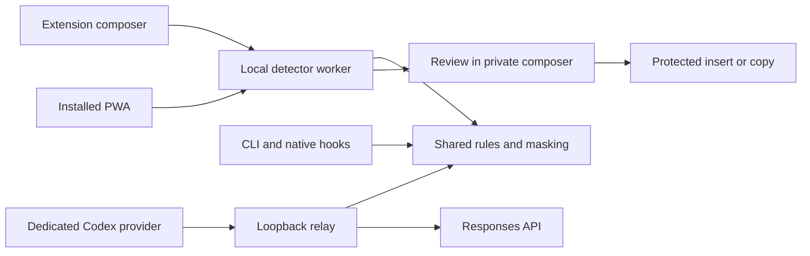

# Architecture

- `packages/contracts` defines finding and result types. `packages/core` performs context checks, overlap resolution, and placeholder generation without selecting a destination.
- `packages/ui` holds the shared composer and scan worker. On origins listed in the extension provider registry, the extension draws a button that opens a Chrome-owned side panel. Raw text stays in that panel and its worker. The scoped content script handles the launch, and the transfer script receives the protected draft only. The PWA uses the browser clipboard after a user action.
- `apps/cli` handles plain text, file I/O, and installer entry points. `adapters/` records each native hook's configuration and response contract.
- `apps/gateway` accepts authenticated requests on loopback and forwards only requests that pass its inspection. It validates the request type, distinguishes protocol fields from maskable content, and streams responses back to Codex.
- The static website links to the PWA and its installation guide. The PWA's service worker caches its application assets.

See the [decision log](decisions/README.md) and the [threat model](threat-model.md). [Chrome extension permissions](https://developer.chrome.com/docs/extensions/develop/concepts/activeTab/) · [Claude Code hooks](https://code.claude.com/docs/en/hooks) · [Codex hooks](https://learn.chatgpt.com/docs/hooks) · [Codex gateway compatibility](https://learn.chatgpt.com/docs/enterprise/gateway-compatibility)
